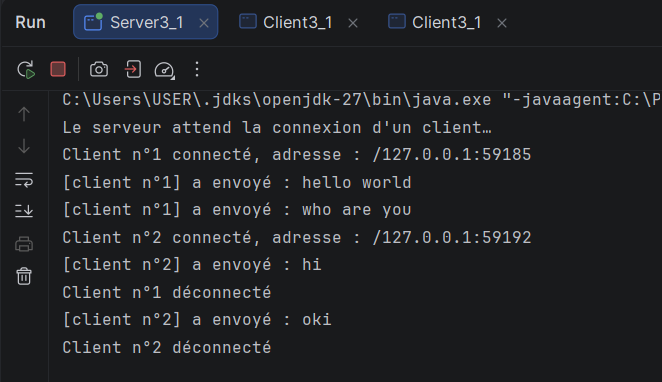
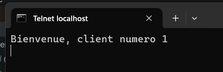
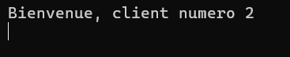
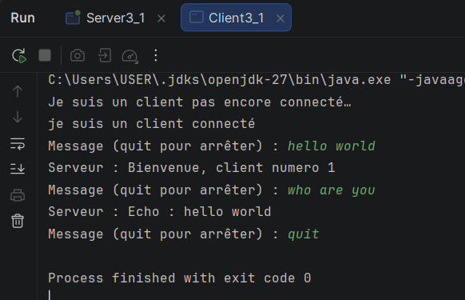
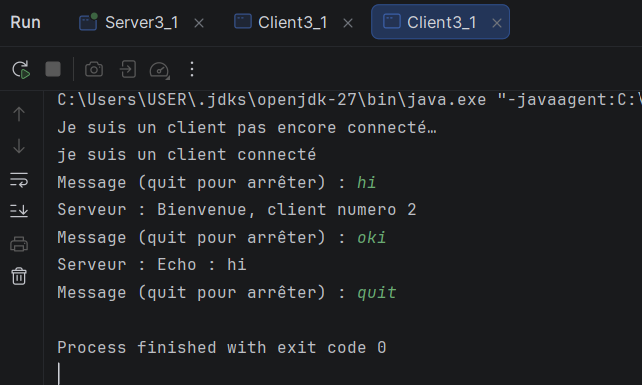
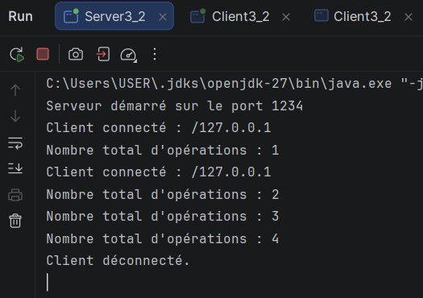
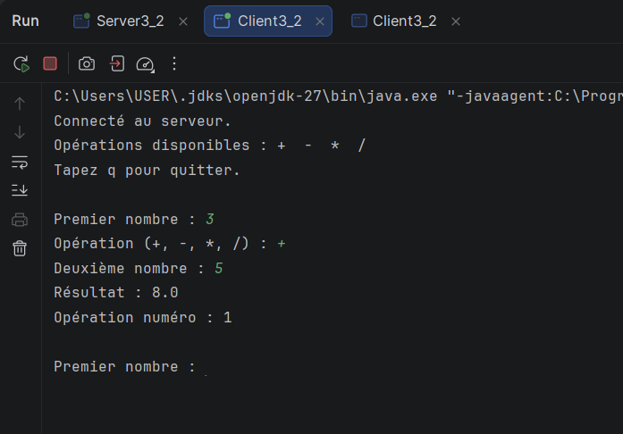
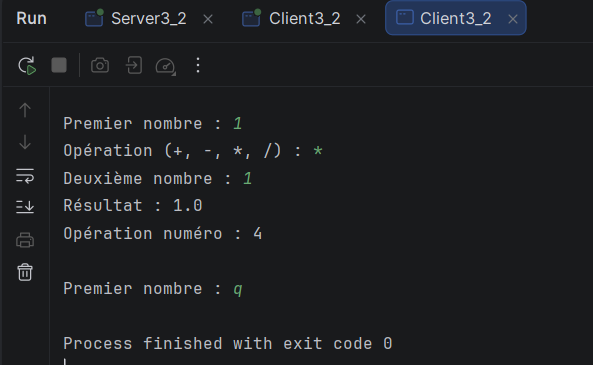

# TP3 - Serveur multithread avec sockets TCP

**Module :** Développement d'applications réparties  
**Niveau :** LSI3  
**Étudiant(e) :** _Votre Nom et Prénom_  
**Année universitaire :** _2025-2026_

## Présentation

Ce projet regroupe les activités 3-1 et 3-2 du TP3. Il met en œuvre un serveur TCP multithread en Java, capable d'accepter plusieurs clients simultanément. L'activité 3-2 étend ce serveur avec un service de calculatrice utilisant des objets Java sérialisés et un compteur global synchronisé.

## Environnement

- JDK 8 ou supérieur
- IntelliJ IDEA, Eclipse ou VS Code
- Git
- Port TCP utilisé par le serveur : `1234` pour le squelette de l'activité 3-1. Pour l'activité 3-2, utiliser le port défini par la constante `PORT` dans `ServeurCalculatrice.java` (exemple : `5000`).

## Organisation suggérée du projet

```text
TP3/
├── src/
│   ├── serveur/
│   │   ├── ServeurMultiThread.java
│   │   ├── ServeurCalculatrice.java
│   │   └── ClientProcess.java
│   ├── client/
│   │   └── Client.java
│   └── commun/
│       ├── RequeteCalcul.java
│       └── ReponseCalcul.java
└── README.md
```

> Les classes `RequeteCalcul` et `ReponseCalcul` doivent avoir le même nom de package (`commun`) dans le projet client et le projet serveur. Les deux côtés doivent utiliser la même version de ces classes pour que la désérialisation fonctionne.

## Activité 3-1 : Acceptation de plusieurs clients

Le serveur ouvre un `ServerSocket`, accepte les connexions dans une boucle et crée un thread dédié pour chaque client. Il affiche l'adresse distante et le numéro d'ordre de connexion, puis envoie ce numéro au client.

### Lancement et tests locaux

1. Démarrer le serveur.
2. Démarrer plusieurs clients Java, ou se connecter avec Telnet au port du serveur, par exemple :

   ```text
   telnet localhost 1234
   ```

3. Vérifier dans la console serveur l'adresse IP et le numéro de chaque client, puis vérifier que le numéro est reçu côté client.

### Test sur le réseau local

Dans `Client.java`, remplacer `localhost` par l'adresse IPv4 de la machine serveur. Les deux machines doivent être sur le même réseau et le port choisi doit être autorisé par le pare-feu.

## Activité 3-2 : Amélioration de l'application calculatrice

Le client envoie au serveur un objet `RequeteCalcul` contenant les deux nombres et l'opérateur. Le serveur calcule le résultat dans le thread associé au client et renvoie un objet `ReponseCalcul`.

Chaque opération réussie incrémente le compteur global. La méthode d'incrémentation est `synchronized` afin de protéger cette ressource partagée entre les threads clients. Le nouveau total est affiché dans la console du serveur et renvoyé au client.

### Opérations prises en charge

- Addition : `+`
- Soustraction : `-`
- Multiplication : `*`
- Division : `/` (division par zéro signalée comme erreur)

### Lancement et tests

1. Démarrer `ServeurCalculatrice`.
2. Démarrer plusieurs instances de `Client`.
3. Effectuer plusieurs opérations en parallèle et vérifier les résultats côté clients.
4. Vérifier que le compteur augmente correctement dans la console serveur.
5. Pour le test réseau, remplacer `localhost` dans le client par l'adresse IP de la machine serveur et vérifier le port configuré dans le code.

## Captures d'écran et synthèse

Ajoutez les captures réalisées pour chaque activité dans les emplacements ci-dessous. Remplacez chaque texte entre crochets par une image ou un lien vers l'image dans votre dépôt.

### Activité 3-1

**Capture 1 - Serveur**  


**Capture 2 - Telnet**  



**Capture 3 - Client1**  


**Capture 4 - Client2**  


### Activité 3-2

**Capture 1 - Serveur**  

**Capture 2 - Client1**  

**Capture 3 - Client2**  


## Dépôt GitHub

**Lien du repository :** _[Coller ici le lien vers le dépôt GitHub du projet TP3]_

## Conclusion

_[Résumer les compétences acquises : sockets TCP, communication client/serveur, threads, sérialisation d'objets et synchronisation d'une ressource partagée.]_
